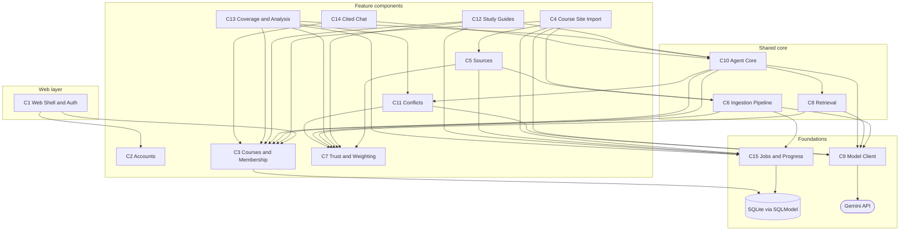
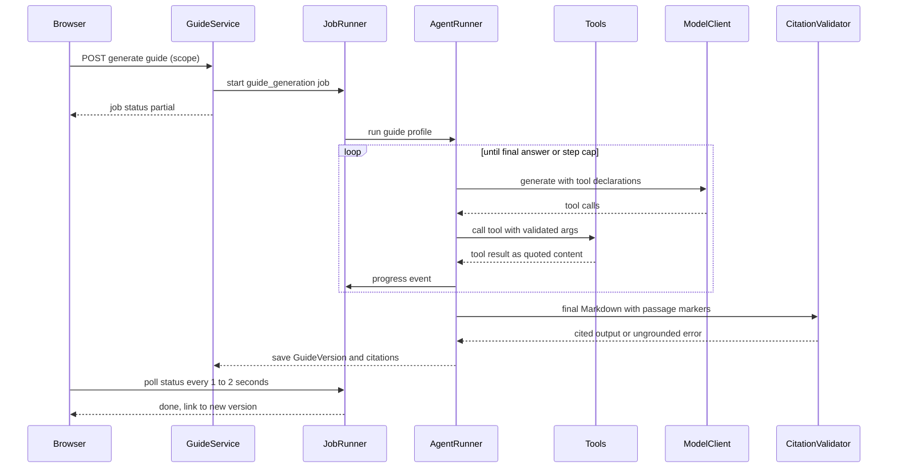
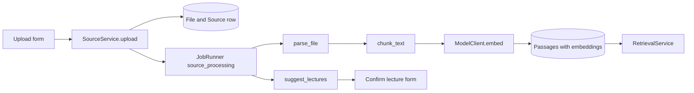

# Margins: Component Dependencies

**Stage**: INCEPTION - Application Design

This document shows which components depend on which, how they communicate, and how data flows through the main features.

---

## 1. Dependency Rules

1. **Dependencies point downward**: feature components → shared core (C8, C10) → foundations (C9, C15, C1). Shared core never imports a feature's *service*.
2. **Table modules and pure modules are leaves.** Each package's `models.py` (SQLModel tables) and its pure-logic modules (`weighting.py`, `decisions.py`, `gaps.py`, `chunk_text`, `validate_public_url`) import nothing from other services. Any component may import them. The matrix below covers service-level dependencies, which must have no cycles.
3. **Agent tools are adapters.** Tools in C10 call feature services (C3, C7, C8, C11) and pure functions (C13 `gaps.py`). They are registered at app startup, so C10's loop itself depends only on C9 and the registry.
4. **All communication is in-process function calls.** There is no message bus. Long work runs through C15 background jobs, and the browser learns about progress by polling.

---

## 2. Dependency Matrix

Read across: the row component **depends on** (calls) the column component. `S` = calls a service, `P` = uses a pure module or the presenter only, `M` = reads tables owned by that component.

| Depends on → | C1 | C2 | C3 | C4 | C5 | C6 | C7 | C8 | C9 | C10 | C11 | C12 | C13 | C14 | C15 |
|---|---|---|---|---|---|---|---|---|---|---|---|---|---|---|---|
| **C1** Web Shell | | S | S | | | | | | | | | | | | |
| **C2** Accounts | | | | | | | | | | | | | | | |
| **C3** Courses | | M | | | | | | | | | | | | | |
| **C4** Site Import | | | S | | S | S | | | S | | | | | | S |
| **C5** Sources | | M | S | | | S | S | | | | | | | | S |
| **C6** Ingestion | | | S | | M | | | | S | | | | | | S |
| **C7** Trust | | M | M | | M | | | | | | | | | | |
| **C8** Retrieval | | | | | P | M | S | | S | | | | | | |
| **C9** Model Client | | | | | | | | | | | | | | | |
| **C10** Agent Core (incl. tools) | | | S | | P | | S | S | S | | S | | P | | |
| **C11** Conflicts | | | M | | P | M | S | | S | | | | | | |
| **C12** Guides | | | S | | M | | S | | | S | | | | | S |
| **C13** Coverage | | | S | | P | | S | | | S | S | | | | S |
| **C14** Chat | | | S | | | | | | | S | | | | | |
| **C15** Jobs | | | M | | | | | | | | | | | | |

**Notes**
- C5 → C7: `SourceService.delete` removes trust rows; `upload` sets an initial weight through `WeightService`.
- C7 → C11 does **not** exist. C11 writes agreement records *through* `TrustService.record_agreement`, so trust stays the owner of weights.
- C1 → C2/C3: auth dependencies load the user and the course role.

---

## 3. Layer Diagram



### Text Alternative

```
Web layer:        C1 Web Shell and Auth -> C2 Accounts, C3 Courses
Features:         C4 Site Import -> C3, C5, C6, C9, C15
                  C5 Sources     -> C3, C6, C7, C15
                  C11 Conflicts  -> C7, C9
                  C12 Guides     -> C3, C7, C10, C15
                  C13 Coverage   -> C3, C7, C10, C11, C15
                  C14 Chat       -> C3, C10
Shared core:      C6 Ingestion   -> C3, C9, C15
                  C8 Retrieval   -> C7, C9 (presenter from C5)
                  C10 Agent Core -> C3, C7, C8, C9, C11 (gaps.py from C13)
Foundations:      C9 Model Client -> Gemini API
                  C15 Jobs        -> SQLite
                  All components store their tables in SQLite through SQLModel.
```

---

## 4. Data Flow: Study Guide Generation



### Text Alternative

```
1. Browser asks GuideService to generate a guide for a scope.
2. GuideService creates a job, starts it in the background, and returns a status partial.
3. The job runs AgentRunner with the "guide" profile.
4. Loop (capped): AgentRunner asks ModelClient for the next turn; the model requests tools;
   AgentRunner validates arguments and runs the tools (retrieval, weights, compare, gaps,
   resolved conflicts); results go back to the model as quoted content; each step adds a
   progress event to the job.
5. The final Markdown with [P<id>] markers goes to CitationValidator, which maps markers to
   note-level citations or rejects ungrounded output.
6. GuideService saves a new GuideVersion and its citations.
7. The browser polls job status every 1-2 seconds and shows the new version when it is done.
```

---

## 5. Data Flow: Note Upload and Indexing



### Text Alternative

```
Upload form -> SourceService.upload -> stores the file and Source row, starts a job
Job: parse_file -> chunk_text -> ModelClient.embed -> Passages with embeddings (SQLite)
Job: suggest_lectures -> the confirm-lecture form appears when the job finishes
RetrievalService later reads the stored Passages and embeddings.
```

---

## 6. Build Order Implied by Dependencies

1. Foundations: C1, C9 (with `FakeModelClient`), C15, database setup
2. C2 Accounts, C3 Courses and Membership
3. C5 Sources, C6 Ingestion, C7 Trust and Weighting
4. C8 Retrieval, C4 Course Site Import
5. C10 Agent Core, C11 Conflicts
6. C14 Chat, C12 Guides, C13 Coverage
7. C16 Evaluation Harness

Units Generation will turn this order into units of work and decide which can be built in parallel.
