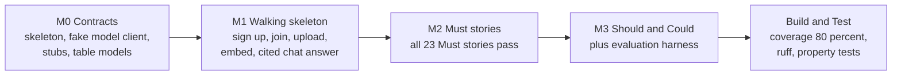

# Margins: Unit of Work Dependencies

**Stage**: INCEPTION - Units Generation

How the five units depend on each other, what each must publish early, and the order in which the team integrates (Q4: A contracts first, Q5: A walking skeleton, Q8: A short branches and reviewed PRs).

---

## 1. Dependency Matrix

Read across: the row unit **depends on** the column unit.
- **C** = needs only the column unit's **contract** (signatures, stubs, table models, `FakeModelClient`), available after milestone M0.
- **F** = needs the column unit's **finished implementation** for its own feature to work end to end.

| Depends on → | U1 Platform | U2 Ingestion | U3 Trust/Retrieval | U4 Agent/Guides | U5 Chat/Coverage |
|---|---|---|---|---|---|
| **U1 Platform and Access** | | | | | |
| **U2 Content Ingestion** | F (auth, courses, outline, jobs) | | C (initial weight on upload) | C (`ModelClient` for embeddings and extraction) | |
| **U3 Trust and Retrieval** | F (auth, course context) | C (`Source`, `Passage`, presenter) | | C (`ModelClient` for conflict grouping) | |
| **U4 Agent Core and Guides** | F (auth, outline, scopes, jobs) | C (presenter) | C (retrieval, weights, conflicts) | | C (`gaps.py`) |
| **U5 Chat, Coverage and Eval** | F (auth, outline, jobs) | C (presenter, sources) | C (conflicts, weights, endorsements) | C (`AgentRunner`, profiles) | |

### Why this has no blocking cycle
At the code level, U3 and U4 use each other (U3 calls the `ModelClient`; U4's tools call U3's services), and U4 and U5 do the same (U4's tool uses `gaps.py`; U5 runs U4's agent). These are **contract dependencies on leaf modules or protocols**, not service-to-service loops:
- `ModelClient` is a protocol in `app/llm/` with no imports from other units.
- `gaps.py` is a pure module with no imports.
- Agent tools live in U4's `app/agent/tools/` and are registered at app startup.

Once the M0 contracts exist, every unit can build and test in parallel using fakes and stubs. Only **U1 is a hard prerequisite** (F) for everyone.

---

## 2. Contracts Each Unit Publishes in M0

| Unit | Contract | Used by |
|---|---|---|
| U1 | Runnable app skeleton; `get_session`; auth dependencies and `CourseContext`; `JobService`/`JobRunner`; `CourseStructureService.get_outline`, `lectures_for_scope`; U1 table models | All |
| U2 | `Source`, `SourceLectureTag`, `Passage` models; `present_source` and `PublicSource`; `SourceService.list_sources`/`get_source` stubs | U3, U4, U5 |
| U3 | `RetrievalService.search` and `RetrievedPassage`; `WeightService.get_weights`; `ConflictService.compare`/`resolved_for_lectures` stubs; `TrustService.course_has_endorsements` | U4, U5 |
| U4 | `ModelClient` protocol, `FakeModelClient`, `GeminiClient` skeleton; `AgentRunner.run`, `AgentProfile`, `ToolContext`; `CitationValidator.validate` signature | All |
| U5 | `gaps.py` (finished, pure); `ChatService.ask` signature | U4 |

Signatures come from `component-methods.md`. A stub returns a fixed, realistic value so other units can test against it. Changing a published contract after M0 needs a PR reviewed by every unit that uses it.

---

## 3. Integration Milestones



### Text Alternative

```
M0 Contracts -> M1 Walking skeleton -> M2 Must stories -> M3 Should and Could -> Build and Test
```

| Milestone | Done when | Contributions |
|---|---|---|
| **M0 Contracts** | `main` runs; every unit's contracts from section 2 are merged; `FakeModelClient` works | U1 skeleton first; U4 model client and fake; others publish stubs and table models |
| **M1 Walking skeleton (key journey, Q5: A)** | A student signs up, joins with a code, uploads a `.md` note, the note is embedded, and chat returns a cited answer, using `FakeModelClient` in an integration test and live Gemini by hand | U1: US-1.1, US-1.2, US-2.3, US-3.5 (minimal); U2: US-4.1 (`.md`/`.txt` only), basic chunk and embed; U3: `RetrievalService.search`; U4: agent loop, `retrieve_passages` tool, citation validator; U5: US-10.1 minimal, integration test |
| **M2 Must stories** | All 23 Must stories meet their acceptance criteria | Every unit's Must list (story map) |
| **M3 Should and Could** | Should stories done, Could stories done or explicitly cut; evaluation harness reports on the planted set | Every unit; U5 runs the evaluation |
| **Build and Test** | pytest green with 80 percent or more coverage on business logic, ruff clean, PBT rules compliant, no live Gemini in the regular suite | All; U5 coordinates integration tests |

---

## 4. Integration Practice (Q8: A)

- Short-lived feature branches per story or small group of stories, named `<unit>/<story-or-topic>` (for example `u2/us-4.1-upload`).
- Merge to `main` through a PR reviewed by at least one other teammate; a PR that changes a published contract is reviewed by the owners of the units that use it.
- `main` must always start the app and pass the test suite.
- Each unit owns its unit and property-based tests; U5 owns `tests/integration/` and the evaluation harness (Q9: A).

---

## 5. Shared Resources and Coordination Points

| Shared resource | Rule |
|---|---|
| `pyproject.toml` / `uv.lock` | Any unit adds a dependency through a PR; U1 resolves lock conflicts |
| SQLite schema | Each unit creates only its own tables (Q6: A); cross-unit foreign keys point at U1 and U2 tables |
| `Source.weight` column | Owned by U2's table, **written only by U3's `WeightService`** |
| Base layout template | U1 owns it; units add their own templates under `app/templates/<package>/` |
| Gemini API key | One key in a local `.env`; never committed |
| Agent tools | Live in U4's `app/agent/tools/`; the unit whose service a tool wraps reviews that tool's PR |
