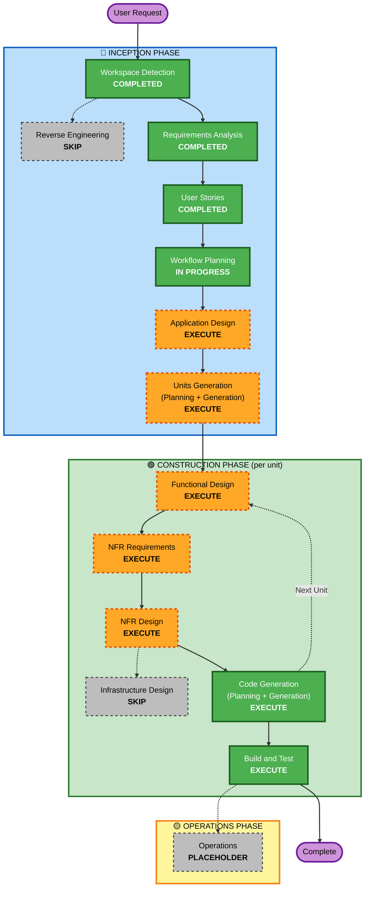

# Execution Plan: Margins

**Inputs loaded:**
- `requirements.md` (approved)
- `requirement-verification-questions.md` and `requirement-clarification-questions.md` (answered)
- `stories.md` and `personas.md` (approved)
- `aidlc-state.md`, including the extension configuration

Reverse Engineering was skipped because this is a greenfield project.

---

## Detailed Analysis Summary

### Transformation Scope
Not applicable (greenfield). Everything is new and lives in a single local FastAPI application.

### Change Impact Assessment
| Area | Impact | Description |
|---|---|---|
| **User-facing changes** | Yes | 39 stories across 10 epics; server-rendered Jinja2 and HTMX pages for four personas |
| **Structural changes** | Yes | New layered app: routes, services (business logic), agent loop and tools, model client, data access |
| **Data model changes** | Yes | New SQLModel schema, roughly: users, courses, memberships, join codes, course requests, lectures, exams, sources (notes, instructor material, website pages), passages with embeddings, upvotes, flags, endorsements, agreement records, conflicts and resolutions, guides and guide versions, chat threads and messages |
| **API changes** | Yes | New HTML and HTMX endpoints, plus internal agent tool schemas (function declarations for Gemini) |
| **NFR impact** | Yes | Security essentials (auth, uploads, safe URL fetching, prompt-injection handling, XSS), LLM reliability (step caps, retries, grounding checks), progress for 2-minute jobs, 80% coverage, property-based testing |

### Component Overview (high level, refined in Application Design)
- **Web layer:** FastAPI routers, Jinja2 templates, HTMX partials, auth dependencies
- **Domain services:** accounts, courses and membership, course requests, notes and sources, ratings and endorsements, weighting, coverage, guides, conflicts, chat
- **Ingestion:** file parsing (`.md`, `.txt`, `.pdf`), chunking, embedding; course-site fetcher and parser with SSRF guards
- **Retrieval:** cosine similarity in numpy, combined with the quality weight
- **Agent:** a function-calling loop written by the team on `google-genai`, with a tool registry, step limits and progress events
- **Model client:** a thin interface over Gemini chat and embeddings, so tests can use fakes
- **Persistence:** SQLModel and SQLite

### Risk Assessment
- **Risk level:** Medium-High. The CRUD parts are well understood. The risky parts are:
  - the quality of Gemini tool calling and citations
  - telling real conflicts apart from wording differences
  - how varied course websites are
  - fitting guide generation into about 2 minutes
- **Rollback complexity:** Easy. It is local and greenfield, with git history.
- **Testing complexity:** Complex. LLM behavior needs fakes in unit tests, an on-demand evaluation script, and property-based tests for the deterministic logic.

---

## Workflow Visualization

### Mermaid Diagram



### Text Alternative

```
Phase 1: INCEPTION
- Workspace Detection ...... COMPLETED
- Reverse Engineering ...... SKIPPED (greenfield)
- Requirements Analysis .... COMPLETED
- User Stories ............. COMPLETED
- Workflow Planning ........ IN PROGRESS
- Application Design ....... EXECUTE
- Units Generation ......... EXECUTE

Phase 2: CONSTRUCTION (repeat per unit)
- Functional Design ........ EXECUTE (every unit)
- NFR Requirements ......... EXECUTE (only units with LLM, fetching, auth or upload work)
- NFR Design ............... EXECUTE (same units as NFR Requirements)
- Infrastructure Design .... SKIP (local only)
- Code Generation .......... EXECUTE (always)
Then:
- Build and Test ........... EXECUTE (always)

Phase 3: OPERATIONS
- Operations ............... PLACEHOLDER
```

---

## Phases to Execute

### 🔵 INCEPTION PHASE
- [x] Workspace Detection (COMPLETED)
- [x] Reverse Engineering (SKIPPED, greenfield)
- [x] Requirements Analysis (COMPLETED)
- [x] User Stories (COMPLETED)
- [x] Workflow Planning (IN PROGRESS)
- [ ] Application Design: **EXECUTE**
  - **Rationale:** Every component is new. The design needs to settle:
    - the service boundaries (weighting, coverage, conflicts, guides, chat)
    - the agent's tool set and its contract with the model client
    - how progress is reported for long jobs
    - component dependencies the four teammates will build against
- [ ] Units Generation: **EXECUTE**
  - **Rationale:** Four teammates need separate units of work with clear interfaces. The system has several modules (ingestion, trust and ranking, agent features, web and accounts) with a real dependency order: the agent needs retrieval, and retrieval needs ingestion and weights.

### 🟢 CONSTRUCTION PHASE
- [ ] Functional Design: **EXECUTE (every unit)**
  - **Rationale:**
    - The data model is new.
    - The business rules are not obvious: the weight formula and its constants, agreement-score smoothing, majority and ties, conflict resolution precedence, coverage thresholds, exam-range selection, and anonymity rules.
    - **The Property-Based Testing extension requires it.** PBT-01 needs a "Testable Properties" section in each unit's functional design.
- [ ] NFR Requirements: **EXECUTE (only units with LLM, fetching, auth or upload work)**
  - **Rationale:** The tech stack is already fixed by TechnicalEnvironment.md, so tech selection is not needed. These units still need concrete NFR decisions:
    - Gemini timeouts, retry and rate-limit behavior
    - agent step and tool-call caps
    - how progress reaches the browser (HTMX polling vs. server-sent events)
    - fetcher page and size caps and SSRF rules
    - how prompts separate instructions from content
    - performance budgets for 2-minute guides
    - the Hypothesis settings (PBT-09)
  - Units with only CRUD skip this stage.
- [ ] NFR Design: **EXECUTE (same units as NFR Requirements)**
  - **Rationale:** Turns those NFR decisions into patterns: a model-client wrapper with retries and fakes, a progress-event mechanism, a safe-fetch module, prompt templates, and grounding checks.
- [ ] Infrastructure Design: **SKIP**
  - **Rationale:** Runs locally only (`uv run fastapi dev`), with a SQLite file, no cloud resources, and no deployment (NFR-1). The only external service is the Gemini API, configured through `.env`.
- [ ] Code Generation: **EXECUTE (ALWAYS)**
  - **Rationale:** Implementation planning and code generation for each unit.
- [ ] Build and Test: **EXECUTE (ALWAYS)**
  - **Rationale:** The build and test instructions will cover:
    - `uv` setup
    - pytest, with a pytest-cov target of 80% or more on business logic
    - ruff lint checks
    - Hypothesis property tests
    - integration tests with a fake model client
    - the on-demand evaluation script

### 🟡 OPERATIONS PHASE
- [ ] Operations: PLACEHOLDER
  - **Rationale:** Future deployment and monitoring workflows. Not needed for a local-only MVP.

---

## Extension Notes
- **Property-Based Testing (enabled, full):**
  - PBT-01 is enforced in Functional Design.
  - PBT-02 to PBT-08 and PBT-10 are enforced in Code Generation.
  - PBT-09 is compliant: Hypothesis was chosen.
  - All of these are N/A at Workflow Planning.
- **Security Baseline / Resiliency Baseline:** disabled; skipped and logged. The security essentials in NFR-2 still apply.

## Estimated Timeline
- **Stages still to run:**
  - Inception: 2 (Application Design, Units Generation)
  - Construction, per unit: up to 4 (Functional Design, NFR Requirements, NFR Design, Code Generation)
  - Then: 1 (Build and Test)
- **Rough effort:** Application Design and Units Generation take about 1-2 working sessions together. Each unit takes about 2-4 sessions from design through code. Units can be built in parallel by different teammates once Units Generation fixes the interfaces. The actual dates depend on the course deadlines, which this plan doesn't know.

## Success Criteria
- **Primary goal:** a working local Margins MVP in which the key journey works end to end. A student signs up, joins a course, uploads notes, and gets cited chat answers. Study guides with conflicts and coverage gaps, and the instructor coverage view, also work.
- **Key deliverables:**
  - application code at the workspace root (`app/`, `tests/`, `pyproject.toml`, `uv.lock`, `.env.example`)
  - the instructor seeding command
  - the evaluation script and planted test set
  - AI-DLC design artifacts for each unit, and the build and test instructions
- **Quality gates:**
  - every Must story's acceptance criteria pass
  - pytest is green, with 80% or more coverage on business logic
  - ruff is clean
  - PBT rules are compliant
  - the regular suite makes no live Gemini calls
  - the evaluation script finds the planted gaps and conflicts
  - security essentials (NFR-2) are verified
